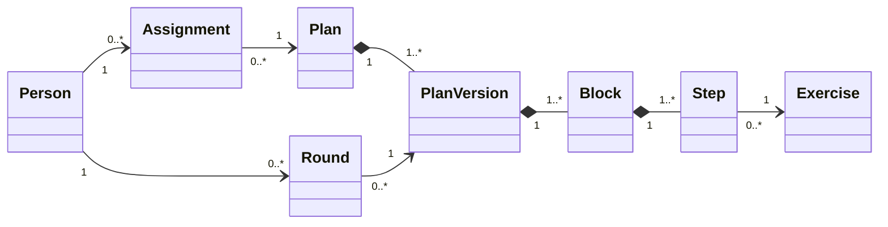
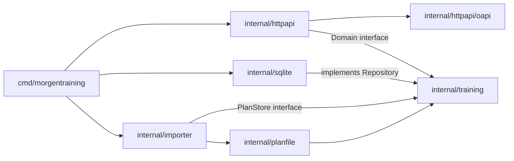

# Morgentraining

A short morning workout timer for the family: a sun ring that fills block by block, with tones, vibration, rests, and the screen kept on. Each person has their own plan and their own streak. One small Go service serves the page and a JSON API and keeps everything in a single SQLite file.

It is meant for a home network. There is **no login**: anyone who can reach the page can pick any person, and anyone who can reach the API can add or change people and plans. Put it behind something that limits access (a LAN-only gateway, later an OIDC proxy).

## Run locally

```bash
go run ./cmd/morgentraining serve -addr 127.0.0.1:8080 -db morgentraining.db
```

Open <http://127.0.0.1:8080>. On first start with an empty database, the plans and people in [`seed/`](seed) are loaded.

> The browser only keeps the screen on (Wake Lock API) on HTTPS pages or `localhost`. On a phone, serve it over HTTPS.

## Managing people and plans

The page **Verwalten** (`/verwalten.html`, linked from the start page and next to "Wechseln") is for adding people and changing their name, language and plan, and for editing plans:
- change blocks and steps (exercise, seconds, own name), reorder or delete them
- add exercises to the shared library
- start a new plan from an existing one

Saving a changed plan creates a new version; saving without a change does nothing. Like the rest of the page it has no login: anyone who can reach it can change people and plans. Its labels are German; error messages from the server are English.

## Plans

A plan is a list of **blocks** (one item in the list and one segment of the ring). Each block has **steps** that point to exercises in a shared library. Exercise kinds: `exercise`, `rest` (a short break inside a block) and `breath` (shows breathe in / breathe out). Names and cues are given per language (`de`, `en`, …), and each person sees their own language, falling back to German, then English.

See [`seed/plan-morgen-5.yaml`](seed/plan-morgen-5.yaml) for the format. To change a plan, edit the YAML and import it, or use the API (`GET` and `PUT /api/plans/{key}`, the same structure as JSON):

```bash
morgentraining import -db morgentraining.db my-plan.yaml   # or: go run ./cmd/morgentraining import …
```

- Changed content saves a **new plan version**. Unchanged content is a no-op.
- Saved versions never change. Every finished round points to the version it used, so history stays exact when the routine grows.
- People follow the newest version of their assigned plan.

People and their plans live in a people file ([`seed/people.yaml`](seed/people.yaml)). A changed `plan:` applies from the day of the import. Importing never deletes anyone.

To add or change one person without a file, use the API (same rules as the import; `201` means added, `200` updated):

```bash
curl -X PUT http://127.0.0.1:8080/api/people/mariana \
  -H 'Content-Type: application/json' \
  -d '{"name":"Mariana","language":"en","plan":"morgen-5"}'
```

## Data model



Schema: [`internal/sqlite/schema.sql`](internal/sqlite/schema.sql).

## API

The API is described in [`api/openapi.yaml`](api/openapi.yaml) (OpenAPI 3.0), and the running service serves it at `/openapi.yaml`. The spec is the source of truth, built **spec-first**:

- [oapi-codegen](https://github.com/oapi-codegen/oapi-codegen) generates the Go types and a typed server interface for `net/http` (package [`internal/httpapi/oapi`](internal/httpapi/oapi), generated code only). The handlers implement that interface, so the code can't offer an endpoint or response the spec doesn't have.
- Every API request is validated against the spec before it reaches a handler (unknown fields, wrong types or formats give `400` with a JSON error).
- The API tests also check every response against the spec, so the code can't drift from it.

After changing the spec, regenerate and test:

```bash
go generate ./... && go test ./...
```

| Method and path | What it does |
| :--- | :--- |
| `GET /api/people` | People to choose from |
| `PUT /api/people/{key}` | Add a person, or change their name, language or plan |
| `GET /api/plans` | All plans with their newest version and length |
| `GET /api/plans/{key}` | The newest version of a plan, in the form it is edited in |
| `PUT /api/plans/{key}` | Create a plan or save a new version (same rules as the import) |
| `GET /api/people/{key}/today?date=YYYY-MM-DD` | Today's plan for that person (in their language) and their stats |
| `POST /api/people/{key}/rounds` | Record a round |
| `GET /healthz` | Liveness |

If the server can't be reached when a round ends, the page keeps the round in the browser and sends it on the next load.

## Code layout



| Package | What it does |
| :--- | :--- |
| [`internal/training`](internal/training) | The domain: people, versioned plans, rounds, streaks. Types such as `Date` and `StepKind`, the rules as plain functions, and `Service` with the use cases. It defines the `Repository` interface it needs (with `PlanCatalog` for reading plans composed in) and knows nothing about HTTP, YAML or SQL. |
| [`internal/sqlite`](internal/sqlite) | `Open` returns a `sqlite.DB` interface (`training.Repository` plus `Backup` and `Close`); the implementation is unexported. Migrations, transactions, backup. Its own row and column types in `rows.go` define what is stored. |
| [`internal/planfile`](internal/planfile) | Reads the plan and people YAML files into domain values. Unknown fields are an error. |
| [`internal/importer`](internal/importer) | Turns plan and people files into service calls, for the `import` command and for seeding an empty database. Depends on a small `PlanStore` interface. |
| [`internal/httpapi`](internal/httpapi) | HTTP handlers. They depend only on the `Domain` interface (the small `Trainer`, `PeopleEditor` and `PlanEditor` interfaces composed) and map between domain and wire types. |
| [`internal/httpapi/oapi`](internal/httpapi/oapi) | Generated from the spec. Not edited by hand. |
| [`cmd/morgentraining`](cmd/morgentraining) | Wiring: an `app` struct holds the parts, and `serve`, `import` and `backup` are its methods. |

Two rules keep the layers independent:

- **Each outer layer owns its types and maps them.** The HTTP JSON types (`oapi`), the YAML documents (`planfile`) and the database rows (`sqlite/rows.go`) are separate types with explicit mapping to and from the domain. The API, the file format and the stored format can each change without touching the domain, and the other way round. The domain types are the shared core and are not copied.
- **Layers talk through interfaces.** The consumer defines what it needs: `httpapi.Trainer`, `httpapi.PeopleEditor`, `httpapi.PlanEditor` and `importer.PlanStore` (implemented by `training.Service`) and `training.Repository`. An implementation package can export an interface that embeds those and keep its struct unexported, like `sqlite.DB`, so nothing outside depends on its internals. A new capability gets a new or composed interface rather than growing an existing one.

Tests follow the same split: pure rules are table-tested; handlers and the importer are tested against fakes (with every HTTP response checked against the spec); the stored format is pinned in the SQLite tests; the service is tested against a real SQLite file, and one end-to-end test wires everything together.

## Container

```bash
docker build -t morgentraining .
docker run -p 8080:8080 -v morgentraining:/data morgentraining
```

Settings (environment): `MT_ADDR` (default `:8080`), `MT_DB` (`/data/morgentraining.db` in the image), `MT_TZ` (`Europe/Berlin`, used for "today" when the page doesn't send a date). The image runs as uid 65532, so the volume must be writable for that user.

Released images are on `ghcr.io/subpathdev/morgentraining:<version>`, and a Helm chart with the same version on `oci://ghcr.io/subpathdev/charts/morgentraining` ([`charts/morgentraining`](charts/morgentraining), settings in its [`values.yaml`](charts/morgentraining/values.yaml)). The chart runs one pod with the database on a volume that is kept when the release is uninstalled, a nightly backup into that volume (7 days, by weekday), and optionally an HTTPRoute and alerts.

Releases are automatic. Commit messages follow [Conventional Commits](https://www.conventionalcommits.org/) (`type(scope): summary`), and CI checks every commit a PR adds. On each push to `main`, [svu](https://github.com/caarlos0/svu) works out the next version from the commits since the last tag:

| Commit | Release |
| :--- | :--- |
| `feat: …` | minor (0.3.0 → 0.4.0) |
| `fix: …` | patch (0.3.0 → 0.3.1) |
| `perf:`, `docs:`, `ci:`, `chore:`, `refactor:`, `test:`, `build:`, `style:`, `revert:` | none (use `fix:` for a change users should get) |
| `feat!: …` or a `BREAKING CHANGE:` footer | major, but a minor bump while the version is 0.x |

If there is a new version, CI pushes the image, then the chart, then creates the tag and the GitHub release. Merge PRs with a merge commit (or make the squash message conventional), because svu reads the commit messages on `main`.

The home cluster runs it from `clusters/smart-home/morgentraining` in `subpathdev/smart-home`, where Renovate opens a PR for each new version.

Check the chart after changing it (CI does the same):

```bash
helm lint charts/morgentraining -f charts/morgentraining/ci-values.yaml
helm template test charts/morgentraining -f charts/morgentraining/ci-values.yaml
```

Run exactly **one** instance per database file. Back up with a consistent copy while it runs:

```bash
morgentraining backup -db /data/morgentraining.db /backup/morgentraining-$(date +%F).db
```

## Development

```bash
go generate ./...   # only after changing api/openapi.yaml
go vet ./... && go test ./...
```
